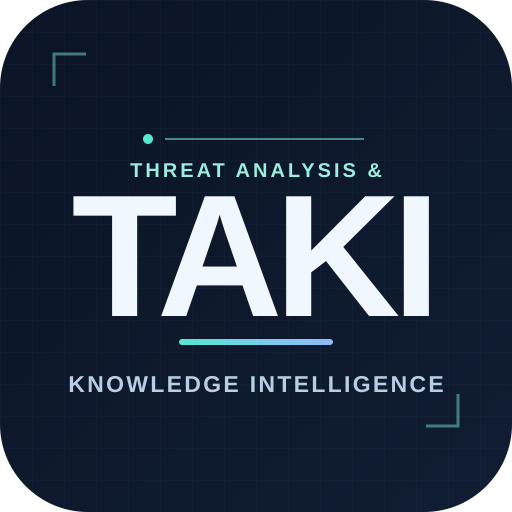

<div align="center">
  
  <h1>TAKI 진단 엔진</h1>
  <p><strong>스캔은 끝났는데, 권한 검사는 어디에 있나요?</strong></p>
</div>

TAKI(Threat Analysis & Knowledge Intelligence)는 CLI로 직접 실행할 수 있는 정적 진단 엔진이다. 설계서의 보안 요구사항을 코드의 호출 흐름과 대조하며, 설계서 없이 코드만 검사할 수도 있다. 정적 분석 도구의 경고를 참고하고, 통제가 구현됐는지 근거와 함께 판정해 수정 방향을 제안한다. 코드는 직접 고치지 않는다.

## 빠른 시작

Python 3.12와 `uv`가 필요하다. 스캐너를 켜면 Docker도 필요하다.

```bash
uv sync
scripts/demo.sh --fake
```

모의 LLM 데모는 규칙 도출 → 승인 → 검사 → 재검사까지 실행한다. 실제 모델을 쓰려면 `taki.example.yml`을 `taki.yml`로 복사해 역할별 모델을 지정하고, API 키를 환경변수 또는 `.env`에 설정한다. 설정 파일과 키는 커밋하지 않는다.

```bash
uv run taki scan TARGET --out runs/code-only
uv run taki scan TARGET --design design.md --out runs/with-design
uv run taki recheck TARGET --previous runs/with-design --design design.md --out runs/recheck
```

설계서에서 규칙 후보를 만들면 검토 후 승인해야 검사에 반영된다.

```bash
uv run taki rules derive TARGET --design design.md --out rules.yml
uv run taki rules approve rules.yml --id R1
uv run taki scan TARGET --design design.md --rules rules.yml --out runs/with-rules
```

## 결과

`--out` 폴더에 `report.html`, `report.json`, `results.sarif`, `ledger.json`을 만든다. 판정은 **구현 확인 / 누락 의심 / 검증 불충분**으로 구분하며, 확인하지 못한 항목을 안전하다고 표시하지 않는다.

CLI 종료 코드는 0(통과), 1(경고), 2(차단), 3(실행 실패)이다. 같은 판정은 `report.json`의 `exit_code`에도 남는다. AI 추정만으로 차단하지 않는다.

## 검증과 현재 범위

```bash
uv run ruff check .
uv run pytest
```

진입점 자동 추출은 현재 Java Spring 중심이다. 다른 언어는 부분적인 폴더 묶음이나 `--slices` 입력을 사용한다. 위험도 점수·배포 확률·기준 문서 RAG는 아직 제공하지 않는다. 이전 `eval/reports/` 수치는 현재 DEV 성능을 뜻하지 않으며, 현재 DEV 결과도 사람 검토 전에는 잠정값이다.

LangSmith 추적을 켜면 프롬프트와 응답이 외부에 저장된다. 비공개 평가 자료를 검사할 때는 추적을 끈다.

엔진은 위 CLI만으로 실행할 수 있다. 검사 대기열과 로컬 HTTP API가 필요하면 [TAKI 서버](https://github.com/what-is-your-vulnerability/taki-server)를 사용한다.
